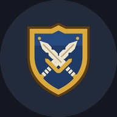
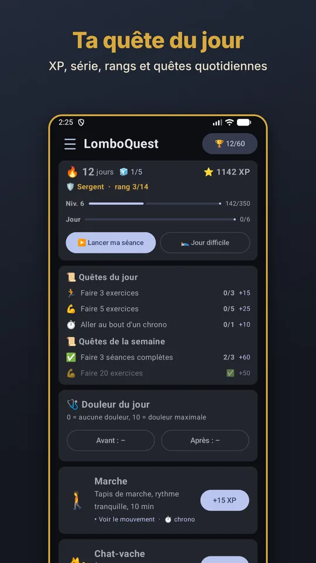
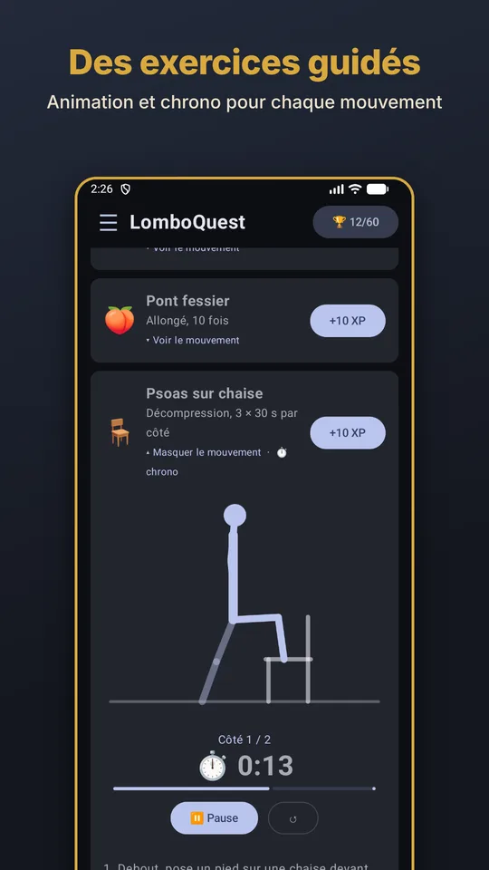
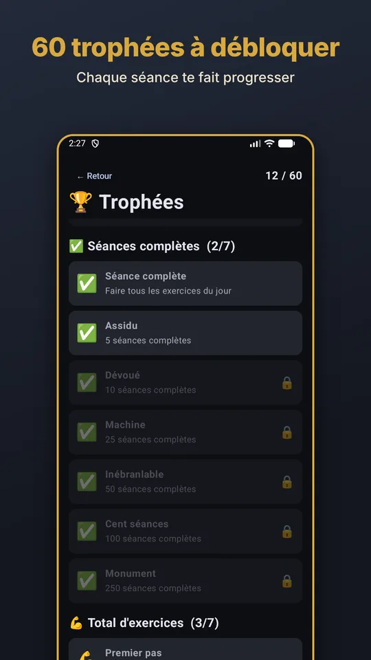
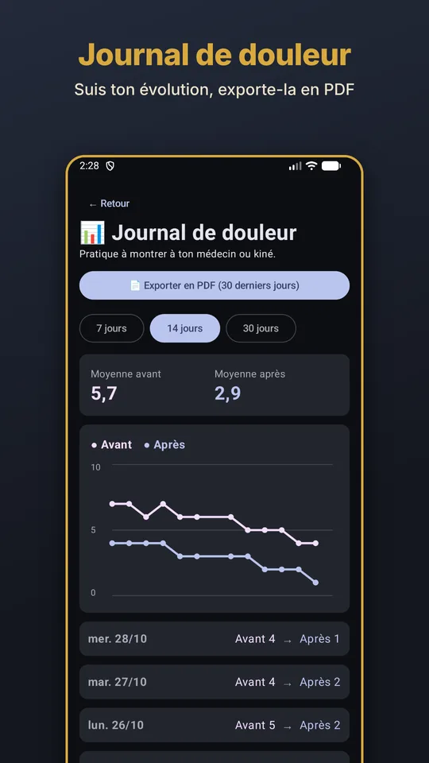

  

<h1 align="center">LomboQuest</h1>

  <b>Exercices doux pour le dos, en mode quête quotidienne.</b> 
  <i>Gentle back exercises, turned into a daily quest.</i>

  🌐 <a href="https://freyr-studio.github.io/lomboquest/">Site / Website</a> ·
  🔒 <a href="https://freyr-studio.github.io/lomboquest/privacy.html">Confidentialité / Privacy</a> ·
  ✉️ <a href="mailto:lomboquest.app@proton.me">Contact</a> ·
  ❤️ <a href="https://fr.tipeee.com/freyrstudio">Me soutenir / Support me</a>

  
  
  
  

## 🇫🇷 Français

LomboQuest transforme tes exercices pour le bas du dos en petite aventure : quelques minutes par jour, de la motivation et des récompenses pour chaque séance.

- 🧍 **Exercices guidés** : animations, chronomètre et séance guidée
- 🏆 **La motivation d'un jeu** : XP, rangs, série de jours, quêtes et 60 trophées
- 🛌 **Journée difficile** : une séance allégée pour les jours où ça tire
- 📊 **Suivi simple** : journal de douleur, calendrier, poids et export PDF
- 🔔 **Rappels et widgets**
- 🔒 **Aucun compte, aucune pub, aucun traceur** : tes données restent sur ton téléphone

Bientôt sur Google Play. Disponible en français, anglais, allemand et russe.

## 🇬🇧 English

LomboQuest turns your lower-back exercises into a small adventure: a few minutes a day, a boost of motivation and rewards for every session.

- 🧍 **Guided exercises**: animations, timer and guided session
- 🏆 **The motivation of a game**: XP, ranks, daily streak, quests and 60 trophies
- 🛌 **Tough day**: a lighter session for the days when it hurts
- 📊 **Simple tracking**: pain log, calendar, weight and PDF export
- 🔔 **Reminders and widgets**
- 🔒 **No account, no ads, no trackers**: your data stays on your phone

Coming soon to Google Play. Available in English, French, German and Russian.

---

⚠️ LomboQuest ne remplace pas l'avis d'un médecin ou d'un kinésithérapeute. / LomboQuest does not replace the advice of a doctor or physiotherapist.

© 2026 FreyrStudio
